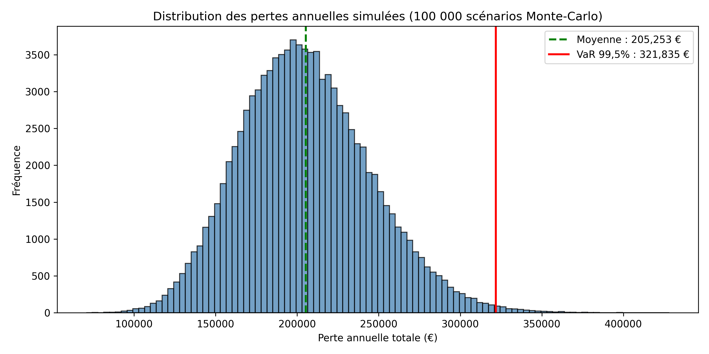

# Stochastic Insurance Loss Modeling (Monte-Carlo & Solvency II)

Simulation of a non-life insurance portfolio across **100,000 annual scenarios** to estimate the pure premium, the Solvency Capital Requirement (SCR) under the **Solvency II (99.5%)** regulatory threshold, and portfolio sensitivity to frequency and severity shocks.

## 1. Mathematical Framework

Aggregate annual claims $S$ are modeled as a compound random sum (collective Frequency-Severity model):

$$S = \sum_{i=1}^{N} X_i$$

* **Frequency ($N$)**: Poisson distribution with parameter $\lambda = 50$ claims/year.
* **Severity ($X_i$)**: Log-normal distribution with parameters $\mu = 8.0$ (median claim cost $e^{8.0} \approx €2,981$) and $\sigma = 0.8$.
* **Numerical Method**: Monte-Carlo simulation ($100,000$ paths) and non-parametric **Bootstrap** resampling ($1,000$ iterations) for confidence interval estimation.

## 2. Key Results

| Actuarial Metric | Estimated Value | Economic Interpretation |
| :--- | :---: | :--- |
| **Expected Annual Loss ($\mathbb{E}[S]$)** | **€205,253** | Portfolio annual pure premium |
| **VaR<sub>99.5%</sub> (Solvency II)** | **€321,835** | 1-in-200-year maximum loss threshold |
| **95% Bootstrap CI for VaR<sub>99.5%</sub>** | **[€319,958 ; €323,414]** | Tail quantile estimator stability ($\pm 0.5\%$) |
| **Implied SCR (VaR<sub>99.5%</sub> − $\mathbb{E}[S]$)** | **€116,582** | Required regulatory economic capital |
| **TVaR<sub>99.5%</sub> (Expected Shortfall)** | **€340,142** | Conditional tail expectation in the worst 0.5% scenarios |



## 3. Sensitivity Analysis (Stress Testing)

Impact evaluation of a **+10% adverse shock** on each individual risk driver:

| Stress Scenario | Stressed VaR<sub>99.5%</sub> | Change vs. Baseline |
| :--- | :---: | :---: |
| **Frequency Shock (+10% claim count, $\lambda = 55$)** | €349,940 | **+8.7%** |
| **Severity Shock (+10% mean claim cost)** | €352,964 | **+9.7%** |

**Takeaway:** Regulatory capital exhibits higher elasticity to claim cost inflation (severity) than to claim count growth (frequency), driven by the heavy right tail of the log-normal distribution.

## 4. How to Run

```bash
pip install numpy matplotlib
python3 simulation.py
